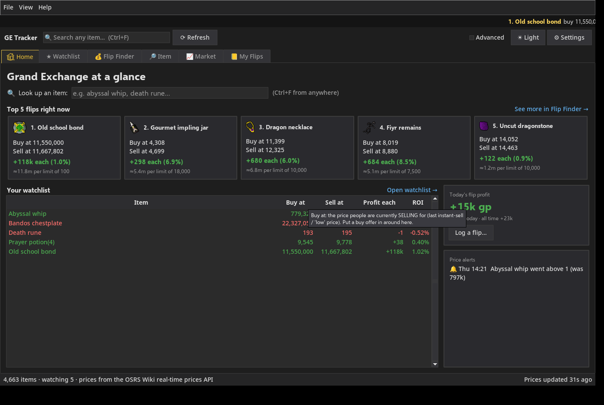
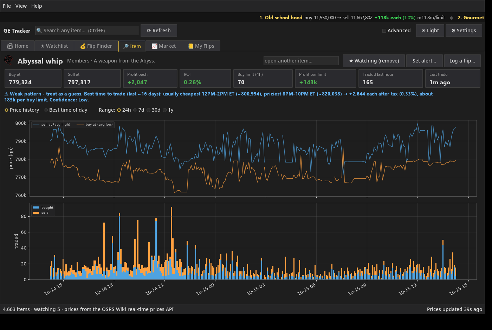
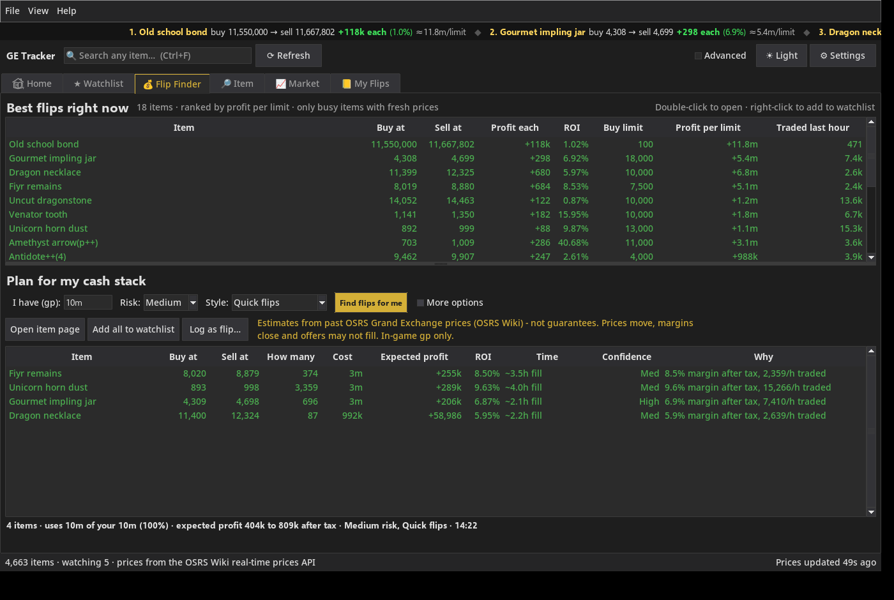
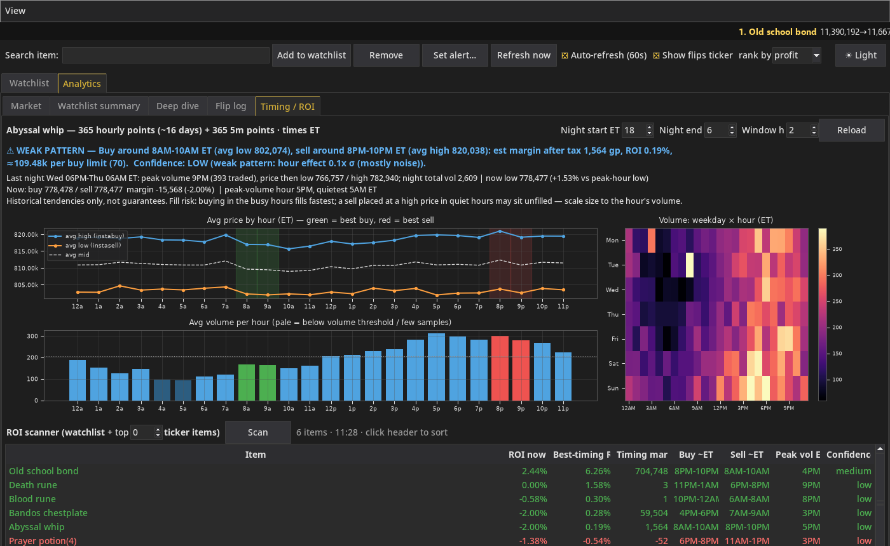
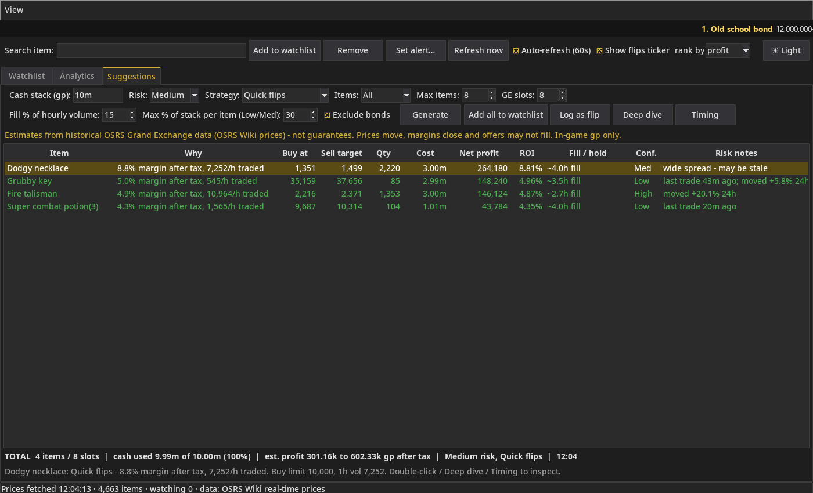

# OSRS GE Tracker

A desktop Grand Exchange tracker for Old School RuneScape, built with Python and Tkinter.



## Features
- **Live prices**: instant buy/sell, margin after GE tax, ROI, buy limit, volume and last trade time.
- **Watchlist & alerts**: track items and get a popup and sound when a price crosses your target.
- **Flip finder**: ranks current flip opportunities by after-tax profit, with volume and staleness filters.
- **Analytics**: market movers, watchlist summary, deep-dive charts (SMAs, spread band), timing/ROI by hour of day.
- **Suggestions**: quick flips, overnight holds and longer-term ideas.
- **Flip log**: record your trades and see realised after-tax profit.
- **Open flips**: log a buy now and enter the sell price when it sells (partial sales supported), with live estimated profit after tax.
- **Light and dark themes.**

| Item view | Flip finder |
|---|---|
|  |  |
| **Analytics (dark)** | **Suggestions** |
|  |  |

## Install and run (Windows)
**Easiest: download the .exe.** Grab `OSRS-GE-Tracker-v0.7.0-windows.exe` from the [latest release](https://github.com/Phantomphreak001/osrs-ge-tracker/releases/latest) and double-click it. No Python needed. The exe is unsigned, so Windows SmartScreen may warn: click **More info → Run anyway**.

**Or run from source:**

1. Install [Python 3.10+](https://www.python.org/downloads/) (Tkinter is included with the standard installer).
2. Download or clone this repository, then in its folder run:
   ```
   pip install -r requirements.txt
   ```
3. Start the app with `python ge_tracker.py`, or double-click `run_ge_tracker.bat`.

It also runs on Linux/macOS if your Python has Tkinter.

Run the tests with `python tests.py` (add `--live` to also make one real API call).

## Margin math
margin = high − tax(high) − low; ROI = margin / low. GE tax is 2% rounded down, capped at
5,000,000 gp per item; exempt items (listed in `TAX_EXEMPT` in `ge_core.py`) pay nothing.

## Data storage
Everything is stored locally in `%APPDATA%\ge-tracker\` on Windows (`~/.local/share/ge-tracker/` elsewhere):
`watchlist.json` (watchlist, alerts, settings), `flips.json` (flip log), `open_flips.json` (open flips: bought, not sold yet) and cached item data/icons.
Nothing is uploaded anywhere.

## Data source
Prices come from the [OSRS Wiki real-time prices API](https://prices.runescape.wiki/api/v1/osrs)
([docs](https://oldschool.runescape.wiki/w/RuneScape:Real-time_Prices)). Thanks to the OSRS Wiki and RuneLite.
The app sends a descriptive User-Agent and rate-limits its requests as the API asks.

## Disclaimer
This project is not affiliated with or endorsed by Jagex Ltd. It only reads publicly available price
data and does not interact with the game client in any way. Profit figures and suggestions are
estimates, not guarantees.

## Contributing
Issues and pull requests are welcome. Please run `python tests.py` before submitting.

## License
[MIT](LICENSE)
